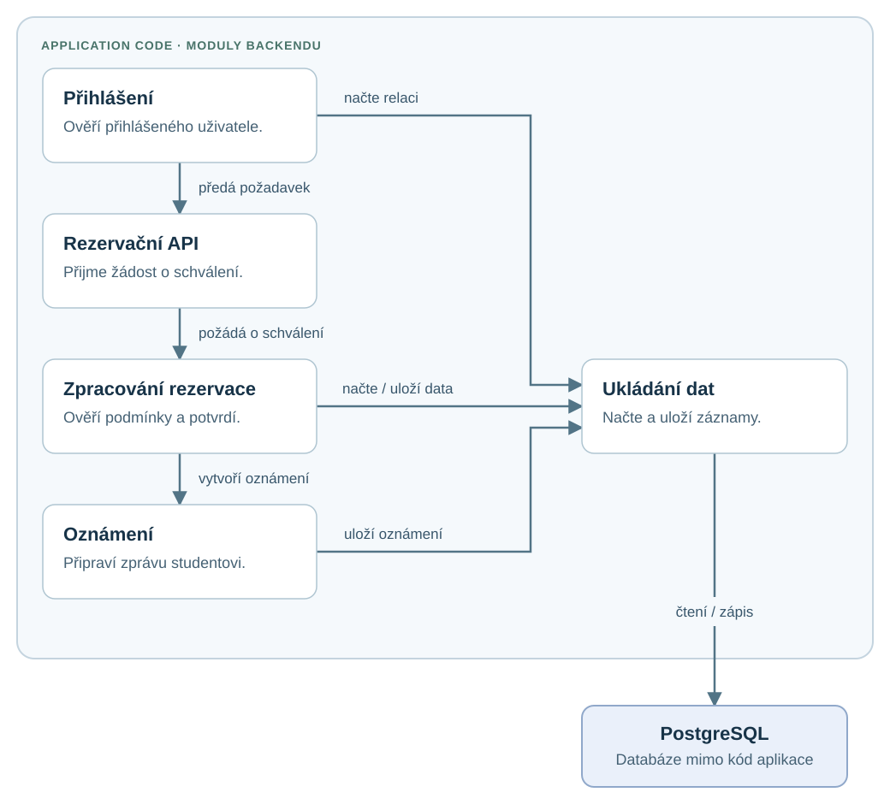
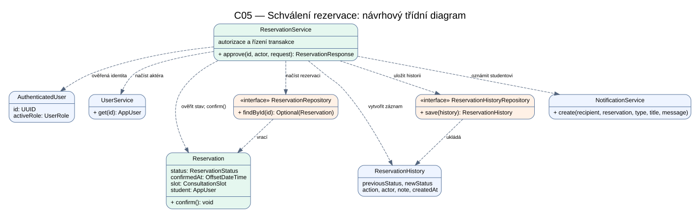
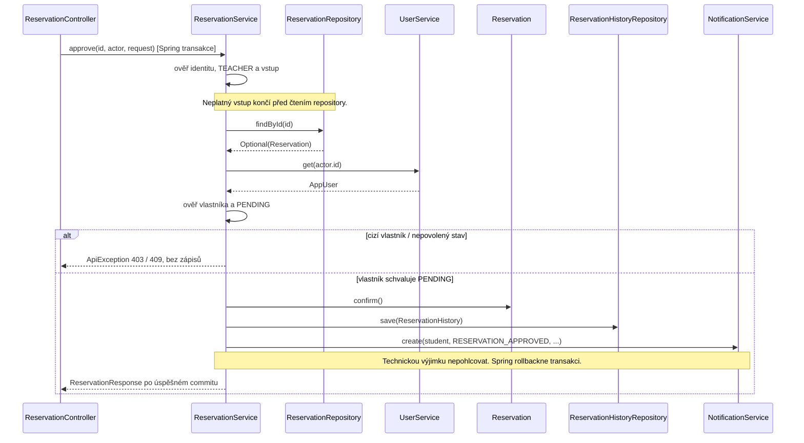

# Architecture and Decisions

## Architecture overview

Aplikace je rozdělena na frontend, backend a relační databázi.

- **Frontend:** React + Vite
- **Backend:** Java 21 + Spring Boot + Maven
- **Databáze:** PostgreSQL
- **Správa databázového schématu:** Flyway migrace

## Main components

- **Frontend** – uživatelské rozhraní pro přihlášení, zobrazení termínů a práci s rezervacemi.
- **Backend API** – REST API, validace požadavků, autorizace uživatelů a business pravidla.
- **PostgreSQL** – ukládá uživatele, konzultační termíny, rezervace, relace přihlášení a historii rezervací.
- **Notification Service** – oznámení po vytvoření, schválení nebo zrušení rezervace. *(ještě ve vývoji)*

## Data model

- `app_users` – uživatelé systému a jejich role.
- `consultation_slots` – termíny vytvořené pedagogy.
- `reservations` – rezervace termínů studenty.
- `reservation_history` – historie změn stavu rezervací.
- `auth_sessions` – relace přihlášených uživatelů.
- `cabinets` – sdílené kabinety; každý pedagog má jeden kabinet a kabinet může mít více pedagogů.
- `reservations.consultation_mode` – forma konkrétní konzultace (`ONLINE` nebo `OFFLINE`).

## Key decisions

### Reservation uses a consultation slot

Student nerezervuje libovolný čas, ale konkrétní termín vytvořený pedagogem. Tím je jednodušší kontrolovat dostupnost termínů a zabránit kolizím.

### Pending reservation blocks the slot

Termín není dostupný nejen při stavu `CONFIRMED`, ale také při `PENDING`. Jeden termín proto nemůže současně rezervovat více studentů.

### Database constraints protect availability

Databáze obsahuje unikátní omezení pro aktivní rezervaci termínu a ochranu proti překryvu aktivních termínů jednoho pedagoga. Backend chyby zachytí a vrací je klientovi jako srozumitelnou odpověď.

### Reservation history is stored separately

Každá změna rezervace se uloží do historie. Lze tak dohledat vytvoření, schválení i zrušení rezervace včetně uživatele, který změnu provedl.

### Authentication uses sessions

Po přihlášení backend vytvoří relaci. Frontend posílá token relace při požadavcích na chráněné API.

### Consultation mode belongs to a reservation

Pedagog při vytvoření termínu povolí online konzultaci, osobní konzultaci nebo obě možnosti. Student si vybírá pouze tehdy, když jsou povolené obě; při jediné možnosti se tato forma zobrazí bez volby. Zvolená forma se uloží k rezervaci a backend kontroluje, že ji termín povoluje. U osobní konzultace se zobrazuje kabinet pedagoga. Online odkaz se v této verzi nevytváří ani neukládá.

### Teachers share cabinets

Kabinet je samostatná databázová entita a pedagog na ni odkazuje cizím klíčem. Jeden kabinet tak může být přiřazen více pedagogům, zatímco pedagog má nejvýše jeden kabinet. Migrace V12 přiřazuje demonstrační pedagogy do tří sdílených kabinetů.

## C03 — Část A: AS-IS mapování scénáře

> Historický stav před opravou identity, výchozí commit `45bf7bd7fd9c4a9f284a7e8d5a5fd9bf125017b8`. Nálezy a výsledky části A ponecháváme jako původní evidenci. Následná oprava je popsána v ADR-01 níže.

### A1. Sledovaný scénář

| Položka | Hodnota |
| --- | --- |
| Scénář / operace | OP-05 — Schválení rezervace (Docs → C02, část 12) |
| Požadavky | REQ-05, související REQ-03 |
| Pravidla / invarianty | BR-02 — Jeden termín může mít nejvýše jednu aktivní rezervaci. |
| Baseline | v0.2 |

### A2. Hlavní průchod scénáře

| Krok scénáře | Jak je realizován | Doklad |
| --- | --- | --- |
| Pedagog vybere čekající žádost. | V přehledu svých žádostí zvolí schválení. | TeacherPage.tsx; client.ts — approveReservation() |
| Systém přijme požadavek. | Backend předá vybranou rezervaci ke zpracování. | ReservationController.approve() |
| Systém načte a ověří rezervaci. | Načte rezervaci a uvedeného uživatele. Ověří vlastnictví termínu a čekající stav. | ReservationService.approve(); UserService.get() |
| Systém potvrdí rezervaci. | Změní PENDING na CONFIRMED a zaznamená čas potvrzení. | Reservation.confirm() |
| Systém uloží výsledek. | Uloží změněnou rezervaci a záznam do historie, kdo a kdy ji potvrdil. | ReservationService.approve(); ReservationHistory |
| Student dostane oznámení. | V aplikaci vznikne oznámení o schválení. API vrátí potvrzenou rezervaci a přehled žádostí se obnoví. | NotificationService.create(); ReservationResponse.from(); TeacherPage.tsx |

Termín je blokovaný už čekající rezervací. Při schválení se kontrola kolize neopakuje; jednu aktivní rezervaci na termín chrání databázový index one_active_reservation_per_slot (migrace V1).

### A3. Chybová větev a nalezený rozdíl

| Co říká v0.2 | Kde se podmínka zjistí | Kde se rozhodne výsledek | Co dostane volající |
| --- | --- | --- | --- |
| Jiný pedagog nesmí rezervaci schválit. | Při porovnání uživatele uvedeného v požadavku s vlastníkem termínu. | ReservationService.approve() požadavek odmítne. | HTTP 403 — schválení není povoleno. Rezervace se nezmění. |

| Specifikace | Současná implementace | Doklad |
| --- | --- | --- |
| Schvalovat může pouze vlastník termínu. | Rozhraní ukazuje pouze vlastní žádosti. Backend ale důvěřuje ID uživatele zaslanému klientem. Test potvrdil, že jiný přihlášený pedagog může přímým požadavkem s ID vlastníka rezervaci schválit. Chyba zatím není opravena. | ReservationController.approve(); ReservationService.approve() |

### A4. Hlavní části implementace

| Část | Typ / obsah | Role ve scénáři | Doklad |
| --- | --- | --- | --- |
| Přihlášení | Modul: BearerTokenFilter, AuthService, SecurityConfig | Ověří přihlášení uživatele. | AuthService.authenticate() |
| Rezervační API | Modul: ReservationController | Přijme požadavek na schválení. | ReservationController.approve() |
| Zpracování rezervace | Modul: ReservationService, Reservation, UserService | Zkontroluje podmínky a potvrdí rezervaci. | ReservationService.approve(); Reservation.confirm() |
| Ukládání dat | Modul: ReservationRepository, ReservationHistoryRepository, AppUserRepository, AuthSessionRepository, NotificationRepository | Načte a uloží potřebná data. | Uvedená rozhraní repository |
| Oznámení | Modul: NotificationService | Vytvoří zprávu studentovi o schválení. | NotificationService.create() |

### A5. Stav a pravidlo

| Otázka | Odpověď | Doklad |
| --- | --- | --- |
| Kde je stav rezervace uložen? | V PostgreSQL, v tabulce reservations. Historie změn je v reservation_history. | Reservation; ReservationHistory; migrace V1 |
| Kdo rozhoduje a mění stav? | Služba rezervací zkontroluje podmínky a poté rezervaci přepne z čekající na potvrzenou. | ReservationService.approve(); Reservation.confirm() |

Pravidlo REQ-05: schválit lze pouze čekající rezervaci vlastníkem termínu. Nedostatek kontroly totožnosti je zaznamenán v A3.

| Otázka | Odpověď | Doklad |
| --- | --- | --- |
| Kde se zjistí podmínka? | Ve službě rezervací se porovná vlastník s uvedeným uživatelem a ověří čekající stav. | ReservationService.approve() |
| Kde se rozhodne? | Stejná služba schválení povolí, nebo požadavek odmítne. | ReservationService.approve() |
| Kde se provede změna? | Objekt rezervace nastaví potvrzený stav a čas potvrzení. | Reservation.confirm() |

### A6. Závislosti

| Závislost | Napojení na aplikaci | Která část zná technické API | Doklad |
| --- | --- | --- | --- |
| PostgreSQL | Ukládá rezervace, uživatele, přihlášení, historii a oznámení. | Část ukládání dat — repository a databázové entity. | Repository z A4; migrace V1, V4 a V11 |
| Interní oznámení | Zpracování rezervace požádá o vytvoření oznámení studentovi. | NotificationService a NotificationRepository. | NotificationService.create() |

Oznámení jsou součástí aplikace a ukládají se do stejné databáze. Externí služba ani externí poskytovatel přihlášení se zde nepoužívají.

### A7. Současné uspořádání scénáře



Konkrétní třídy jednotlivých bloků:

- Přihlášení: BearerTokenFilter, AuthService, SecurityConfig.
- Rezervační API: ReservationController.
- Zpracování rezervace: ReservationService, Reservation, UserService.
- Ukládání dat: ReservationRepository, ReservationHistoryRepository, AppUserRepository, AuthSessionRepository, NotificationRepository.
- Oznámení: NotificationService.

### A8. Otázka pro další návrh

| Položka | Obsah |
| --- | --- |
| Otázka | Jak zajistíme, aby schválení vždy vycházelo z identity přihlášeného uživatele? |
| Doklad | Kontrola nyní používá ID zaslané klientem. Obejití této kontroly potvrdil test uvedený v A3. |
| Proč je důležitá | Pouze vlastník termínu smí rozhodovat o jeho rezervaci. |

### A9. AI a ověření

AI pomohla dohledat části kódu a připravit diagram. V běžící aplikaci jsme přes API provedli 9 testů a ověřili výsledky také v databázi:

| Co jsme testovali | Výsledek |
| --- | --- |
| Vlastník schvaluje čekající rezervaci. | HTTP 200. Rezervace přešla na CONFIRMED; uložil se čas potvrzení, záznam do historie a oznámení studentovi. |
| Jiný pedagog a student posílají vlastní ID (2 testy). | HTTP 403. Rezervace, historie a oznámení zůstaly beze změny. |
| Vlastník schvaluje již potvrzenou nebo zrušenou rezervaci (2 testy). | HTTP 409. Rezervace, historie a oznámení zůstaly beze změny. |
| Neexistující rezervace nebo uživatel uvedený v požadavku (2 testy). | HTTP 404. Testovací data se nezměnila. |
| Jiný přihlášený pedagog pošle ID vlastníka při schválení. | HTTP 200. Cizí rezervace byla potvrzena — chyba oprávnění se potvrdila. |
| Jiný přihlášený pedagog pošle ID vlastníka při zrušení čekající rezervace. | HTTP 200. Cizí rezervace byla zrušena — stejná chyba se potvrdila i zde. |

Testovali jsme na dočasných účtech a rezervacích, které jsme potom odstranili. Chyba oprávnění je zaznamenaná v A3 a zatím není opravena.

## ADR-01 — Odkud pochází identita při schválení a zrušení rezervace?

**Stav:** přijato a implementováno 2026-10-08.

**Kontext:** Část A3/A9 prokázala, že klient mohl v `actorUserId` podstrčit ID vlastníka. Kontrola vlastnictví tak porovnávala identitu dodanou klientem místo skutečně přihlášeného uživatele. Stejný problém se týkal rušení rezervace.

**Drivery:** REQ-05/REQ-03 — schvaluje vlastník termínu; REQ-04/BR-03 — ruší oprávněný aktér; konzistentní stavové přechody a pravdivá identita v auditní historii. BR-02 a jeho databázová ochrana zůstávají zachované.

**Alternativa A:** API načte ověřenou identitu a samo rozhodne o vlastnictví; služba provede změnu stavu. Vyžaduje zpřístupnění rezervace vstupní vrstvě a další vstup do služby by musel kontrolu oprávnění zopakovat.

**Alternativa B:** API předá ověřenou identitu službě rezervací. Služba společně rozhodne o roli, vlastnictví a povoleném přechodu a uloží historii. Další vstupy musí rovněž dodat důvěryhodnou identitu, ale neopakují pravidla vlastnictví.

**Scénář pro obě varianty:** Vlastník schválí PENDING rezervaci; cizí přihlášený pedagog odešle ID vlastníka. V A se cizí pedagog odmítne na vstupu API, v B ve službě rezervací. V obou variantách musí rozhodovat identita z přihlášení a při odmítnutí nesmí vzniknout změna stavu, historie ani oznámení.

**Rozhodnutí a důvod:** B. `BearerTokenFilter` ověří relaci, `ReservationController` převezme `AuthenticatedUser` přes `@AuthenticationPrincipal` a předá jej `ReservationService`. Pravidla oprávnění a stavu mají společného vlastníka ve službě rezervací. Doménové objekty nečtou HTTP ani bezpečnostní kontext.

**Přijaté negativní důsledky:** Služba závisí na interním typu `AuthenticatedUser`; případný nový vstup musí zajistit důvěryhodný původ tohoto objektu. Aktivní role relace rozhoduje, zda uživatel jedná jako student nebo pedagog. Starší pole `actorUserId` se u těchto dvou endpointů kvůli kompatibilitě ignoruje, takže starší klienti nejsou nuceni ihned přestat pole posílat.

**Rozhodnutí znovu otevřeme, když:** přibude jiný vstup do schvalování (např. automatický proces), delegované schvalování nebo změna modelu rolí.

### AS-IS → TO-BE: oprava identity

| Oblast | Původní verze | Opravená verze | Akce |
| --- | --- | --- | --- |
| Identita při approve/cancel | `ActorRequest.actorUserId` z těla HTTP požadavku | `AuthenticatedUser` z ověřené relace | CHANGE |
| Rozhodnutí o oprávnění | Vlastnictví porovnáno s ID od klienta | Služba ověřuje aktivní roli a vlastnictví skutečného aktéra | CHANGE |
| Frontend | Odesílá ID aktéra | Odesílá token a případnou poznámku; tělo schválení je `{}` | CHANGE |
| Audit změny | Aktér odvozen z těla požadavku | Aktér odvozen z ověřené relace | CHANGE |
| Stav, historie a interní oznámení | Zpracování ve službě rezervací v transakci | Stejné uspořádání | KEEP |
| Exkluzivita termínu | Databázový index pro PENDING/CONFIRMED | Stejné omezení | KEEP |
| Odmítnutí podstrčeného ID | Zaznamenané obejití kontroly | Opakovatelné regresní testy API a služby | VERIFY |

**Rozsah:** schválení a rušení rezervací. Vytváření rezervací, správa termínů a ostatní endpointy nejsou touto opravou revidované; další použití klientských ID vyžaduje samostatnou kontrolu. Tato dílčí oprava nepředstavuje dokončení všech bodů C03.

### ADR-01 — navazující sjednocení vlastníka změn lifecycle (2026-10-26)

Následná revize A2/A4 rozšířila původní rozhodnutí na všechny cesty změny lifecycle. `ReservationController.create()` předává `AuthenticatedUser` a `ReservationService.create()` odvozuje studenta z přihlášení. Oba endpointy rušení slotu nyní předávají ověřeného aktéra do `ReservationService`; pokud slot obsahuje aktivní rezervaci, její přechod, kontrola oprávnění, časová hranice, historie a oznámení proběhnou stejnou cestou jako při samostatném zrušení. Změna rezervace i slotu proběhne v jedné transakci. `ConsultationSlotService` již neprovádí přechod rezervace.

| Oblast | Sjednocené chování | Ověření |
| --- | --- | --- |
| Vytvoření rezervace | Aktér z `AuthenticatedUser`; žádné ID studenta z těla | `ReservationAuthorizationTests` |
| Zrušení slotu bez aktivní rezervace | Aktér a vlastník ověření v `ReservationService` | API regresní test |
| Zrušení slotu s aktivní rezervací | Lifecycle, historie a oznámení zpracuje `ReservationService` | API regresní test |

Původní záznam výše zůstává historickým rozsahem rozhodnutí z 8. 10.; toto doplnění zaznamenává jeho rozšíření a sjednocení implementace.

## C05 Detailed Design

### 1. Vybraná jednotka a cíl návrhu

Rozpracováváme **schválení rezervace pedagogem** v metodě `ReservationService.approve`. Tato jednotka patří do správy rezervací z C03. Jejím cílem je bezpečně změnit čekající žádost na potvrzenou a společně se změnou uložit historii a oznámení studentovi.

| Vazba na předchozí zadání | Význam pro tento návrh |
| --- | --- |
| OP-05, REQ-05; související REQ-03 | Pedagog schvaluje žádost o svůj konzultační termín. |
| ADR-01 | Identita pedagoga pochází z ověřeného přihlášení. |
| BR-02 | Termín má nejvýše jednu aktivní rezervaci; PENDING i CONFIRMED jej blokují. |

**Návrhový záměr:** o oprávnění a povoleném přechodu rozhoduje služba rezervací. Kontroly proběhnou před změnou dat; kontrola identity a role navíc před načtením rezervace. Stav, historie a oznámení se mají uložit společně, nebo se nemá uložit nic. Tato pravidla určují, co má implementace splnit a co mají ověřovat testy.

Rozsah zahrnuje přechod PENDING → CONFIRMED. Vytváření a rušení rezervací mají vlastní pravidla a do tohoto návrhu nepatří. Část implementace již existuje; její shodu s návrhem vyhodnocujeme zvlášť v evidenci.

### 2. Podrobné odpovědnosti (detailed responsibilities)

| Odpovědnost | Proč je potřebná? |
| --- | --- |
| D1: Ověřit přihlášeného uživatele a jeho aktivní roli | Nepřihlášený uživatel ani student nesmí schvalovat nebo tímto voláním zjišťovat existenci rezervace. |
| D2: Ověřit vstup a načíst rezervaci i pedagoga | Musíme rozlišit neplatný vstup a neexistující záznam. |
| D3: Ověřit vlastníka termínu a čekající stav | Schvalovat smí pouze vlastník a pouze rezervaci PENDING. |
| D4: Potvrdit rezervaci a zaznamenat čas | Výsledný stav a čas potvrzení musí být jednoznačné. |
| D5: Vytvořit historii změny a oznámení | Musí být dohledatelné, kdo rezervaci schválil, a student musí dostat informaci. |
| D6: Zajistit společné uložení a předat chybu volajícímu | Částečně uložená změna se nesmí vydávat za úspěšné schválení. |

### 3. Rozdělení odpovědností a vlastnictví dat

| Odpovědnost | Vlastník | Data nebo stav | Proč zde? |
| --- | --- | --- | --- |
| D1–D3: rozhodnutí o povolení operace | ReservationService | Identita, aktivní role, ID, stav rezervace | Pravidla platí pro každého volajícího služby, nejen pro HTTP controller. |
| D2: načtení rezervace | ReservationRepository | Reservation nebo prázdný výsledek | Rozhraní odděluje logiku služby od databáze. |
| D2: načtení pedagoga | UserService | AppUser podle ověřeného ID | Dodá uživatele pro kontrolu a historii; o schválení nerozhoduje. |
| D4: změna rezervace | Reservation | status, confirmedAt; vazby na termín a studenta | Entita uchovává stav a provede jeho změnu po kontrolách služby. |
| D5: historie | ReservationHistory; ReservationHistoryRepository | Předchozí a nový stav, akce, aktér, poznámka | Záznam uchovává doklad změny; repository ho ukládá. |
| D5: oznámení | NotificationService | Student, rezervace, typ a obsah oznámení | Služba rezervací určí příjemce; oznámení vytvoří specializovaná služba. |
| D6: společné uložení | ReservationService a transakční podpora Spring | Změna rezervace, historie a oznámení | Jedna transakce zahrnuje všechny tři zápisy. |

### 4. Rozhraní a kontrakty

```java
ReservationResponse approve(UUID reservationId,
    AuthenticatedUser actor, ReservationTransitionRequest request);

// Rozhraní ReservationRepository dědí tuto operaci z JpaRepository:
Optional<Reservation> findById(UUID id);
```

`approve` přijímá ID rezervace, důvěryhodnou identitu a požadavek s volitelnou poznámkou `note`. Identitu vytváří autentizační vrstva; služba sama token neověřuje. Podmínky úspěchu a chybové výsledky jsou v části 6.

Kontrakt `findById`: vstupní ID nesmí být null. Výstup obsahuje nalezenou rezervaci, nebo `Optional.empty`, pokud neexistuje. Chyba databáze se předává volajícímu. Operace nezaručuje výlučné uzamčení rezervace.

### 5. Strukturální UML pohled




[Upravitelný zdroj diagramu](diagrams/c05-reservation-lifecycle.dot). Osm prvků zahrnuje službu, vstupní identitu, doménový stav a skutečná rozhraní repository. Pravidla jsou uvnitř ReservationService; samostatná třída Policy nevzniká.

### 6. Významné operace a pořadí rozhodování


| Položka | approve(id, actor, request) | Reservation.confirm() |
| --- | --- | --- |
| Odpovědnost | D1–D6; autorizovat a koordinovat schválení | D4; změnit stav a čas |
| Vstup | UUID rezervace, ověřená identita, request s volitelnou note | Žádné parametry |
| Výstup | ReservationResponse s CONFIRMED a confirmedAt | void |
| Preconditions | Aktér a role TEACHER; nenulové ID/request; rezervace existuje; vlastník; PENDING | Služba již ověřila oprávnění a PENDING |
| Postconditions | Úspěšný commit stavu, historie a interního oznámení | status=CONFIRMED; confirmedAt nastaven; slot/student zachovány |
| Side effects | Načtení uživatele/rezervace, změna entity, dva související zápisy | Změna entity v paměti, načtení systémového času |
| Failure behavior | 401/403/400/404/409 dle tabulky; technické RuntimeException propagovat | Preconditions jsou odpovědností služby; metoda samostatně neautorizuje |

**Algorithm / decision logic:** pravidla mají následující prioritu (první neúspěch ukončí operaci).

| Pořadí | Podmínka | Výsledek při nesplnění |
| --- | --- | --- |
| 1 | actor != null | 401; bez přístupu k repository |
| 2 | actor.activeRole == TEACHER | 403; bez přístupu k repository |
| 3 | id != null a request != null | 400; bez přístupu k repository |
| 4 | findById(id) obsahuje rezervaci | 404; bez zápisu |
| 5 | UserService.get(actor.id) najde aktéra | 404; bez zápisu |
| 6 | slot.teacher.id == actor.id | 403, i když už rezervace není PENDING |
| 7 | status == PENDING | 409; bez nové historie/oznámení |
| 8 | confirm; save history; create notification | Technická chyba se propaguje; žádná úspěšná response |

```text
ověř identitu, roli a tvar vstupu
načti rezervaci a aktéra
ověř vlastnictví a PENDING
reservation.confirm()
history.save(CONFIRMED, PENDING, CONFIRMED, actor, request.note)
notifications.create(reservation.student, RESERVATION_APPROVED, ...)
vytvoř response; transakční interceptor provede commit
```

### 7. Stavy a podmínky uložení

Následující tabulka platí po úspěšném ověření vstupu, identity a vlastnictví. Cizí pedagog je odmítnut dříve, než služba rozhoduje podle stavu.

| Výchozí stav | Operace | Výsledek | Historie a oznámení |
| --- | --- | --- | --- |
| PENDING | approve vlastníkem | CONFIRMED, nový confirmedAt | Jeden nový záznam historie a jedno oznámení studentovi při úspěšném samostatném volání |
| CONFIRMED | approve vlastníkem | 409; původní confirmedAt zůstává | Bez nových záznamů |
| CANCELLED | approve vlastníkem | 409; stav zůstává | Bez nových záznamů |

**Invarianty úspěchu:** ID rezervace, student a termín se nemění. Schválení neuvolňuje termín, protože PENDING i CONFIRMED jsou aktivní stavy. Historie obsahuje akci CONFIRMED, přechod PENDING → CONFIRMED a skutečného přihlášeného pedagoga. Poznámka je volitelná; null je platná hodnota. Opakované schválení vrací konflikt, nikoli další úspěch.

**Kontrakt selhání:** validační a autorizační chyby nastávají před změnou entity. Technická chyba po `confirm()` může změnit objekt v paměti, ale nesmí zanechat potvrzenou rezervaci ani novou historii či oznámení v databázi. Tato atomická vlastnost vyžaduje volání přes Spring transakční proxy a účast všech zápisů ve stejné transakci. Přímé volání objektu služby v unit testu rollback neprokazuje. Kódy 400/401/403/404/409 v tomto DD označují status v `ApiException`; HTTP filtr nebo validace požadavku mohou chybný požadavek odmítnout ještě před voláním služby.

**Uložení:** JPA sleduje změnu načtené entity a zapíše ji při dokončení transakce (dirty checking). Proto `approve` nemusí samostatně volat `reservations.save`. Interní oznámení se ukládá do stejné databáze.

**Souběh:** tento návrh dosud nezajišťuje, aby dvě současná schválení stejné rezervace vytvořila pouze jednu historii a jedno oznámení. Unikátní index pro aktivní rezervaci termínu tento problém neřeší. Ochrana souběhu zůstává otevřeným návrhovým rizikem.

### 8. Detailní sekvence schválení




### 9. Testy odvozené z návrhu

Z D1–D3 vyplývají testy odmítnutí neplatného vstupu, neoprávněného uživatele a nepovoleného stavu. D4–D5 vyžadují test úspěšného přechodu, správného aktéra v historii a správného příjemce oznámení. D6 vyžaduje ověření předání technických chyb a společného uložení dat.

[Tabulka testů a výsledků](evidence-and-evolution.md#c05-dd-verification-evidence) propojuje každé rozhodnutí s konkrétním testem a vysvětluje volbu testovací úrovně. Unit testy používají náhrady databázových závislostí (mocky); samy nemohou prokázat vrácení databázové transakce zpět.

Pro ověření této vlastnosti stanovujeme dva integrační testy: selhání historie a selhání oznámení. Test připraví a uloží PENDING rezervaci, zavolá službu přes transakční podporu Spring a vyvolá chybu příslušného zápisu. Potom v nové transakci ověří PENDING, nenastavený confirmedAt a nezměněné počty historie i oznámení. Automatický rollback samotného testu se nesmí zaměnit za důkaz rollbacku služby. Tyto případy jsou implementované v ReservationApprovalPersistenceTests; výsledek běhu je uveden v evidenci. Doplňuje je pozitivní kontrola úspěšného uložení všech tří změn.

### 10. Detaily ponechané kódu

V kódu ponecháváme gettery, jednoduché mapování výsledku, přesné znění oznámení a syntaxi frameworkových anotací. Význam transakční hranice je však součástí návrhu výše.

Pravidla nyní vlastní jedna služba. Samostatnou třídu pro rozhodovací pravidla přidáme teprve tehdy, pokud vzniknou různé způsoby schvalování a bude potřeba je oddělit.
